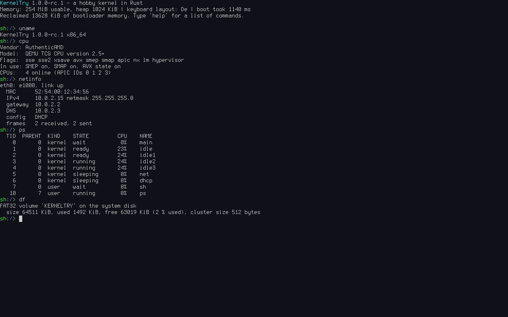

# YAK – Yet Another Kernel

[](https://github.com/FreakySneaky787/yak-kernel/actions/workflows/check.yml)

A small x86-64 operating system written from scratch in Rust, for **learning how a kernel works** by reading,
running, testing and changing one. It runs in QEMU (BIOS and UEFI).

**Website:** [freakysneaky787.github.io/yak-kernel](https://freakysneaky787.github.io/yak-kernel/) – the documentation below as a
book with navigation and search.



> **Status:** pre-release **0.8.0** – a hobby / learning project, working towards release 1.0 (see [docs/GOALS.md](docs/GOALS.md) and
> stage 8 in [docs/PROGRESS.md](docs/PROGRESS.md)). The project is developed together with an AI assistant.

## What is in it
| Area | What YAK does |
|---|---|
| Boot | Limine boot protocol, BIOS and UEFI, higher-half kernel |
| CPU | own GDT/TSS/IDT, local APIC + I/O APIC, every core from the ACPI MADT started via INIT/SIPI (QEMU: 4), SMEP/SMAP, x87/SSE/AVX state per thread |
| Memory | bitmap frame allocator, 4-level paging, guarded kernel stacks, kernel heap, demand-paged user heaps and stacks |
| Scheduling | preemptive round-robin SMP scheduler, kernel and user threads, futexes, sleeping mutexes |
| Processes | ring 3, one address space per process, ELF loader, 53 syscalls, signals, pipes, environment variables |
| Storage | PCI, AHCI SATA driver with MSI, sector cache, FAT32 with long file names – persistent across reboots |
| Network | e1000, Ethernet/ARP/IPv4/ICMP/UDP/TCP, DHCP, DNS client, `wget` and `httpd` |
| User space | `/bin/sh` (pipes, redirection, scripts, `if`/`while`/`for`, functions, jobs), a full-screen editor and 37 more programs (tools, network clients/servers, self-tests) |

Everything above is our own code. The only crates are `limine` (boot protocol) and `spin` (locks).

What it is **not**: a Linux replacement, POSIX-compatible, a desktop system or a driver collection for real hardware.

## Quick start
Host packages (names for Fedora / Debian-Ubuntu):

| Tool | Fedora | Debian / Ubuntu |
|---|---|---|
| QEMU | `qemu-system-x86` | `qemu-system-x86` |
| UEFI firmware (optional, for `run-uefi`/`e2e-uefi`) | `edk2-ovmf` | `ovmf` |
| ISO builder | `xorriso` | `xorriso` |
| FAT tools | `dosfstools mtools` | `dosfstools mtools` |
| Build tools | `make gcc binutils git python3` | `make gcc binutils git python3` |
| Debugger (optional) | `gdb` | `gdb` |

Rust comes from [rustup](https://rustup.rs) (not from the distribution). The exact nightly compiler is pinned in
`rust-toolchain.toml`; inside the repository, rustup installs it with
```sh
rustup toolchain install      # reads rust-toolchain.toml (rustup ≥ 1.28)
```

Then:
```sh
make deps        # checks the host tools and prints the install command for missing ones
make run         # build everything, boot in a QEMU window; serial output in the terminal
make check       # all tests: in-kernel tests, end-to-end shell sessions under BIOS and UEFI
```
The first build downloads the Limine binaries into `vendor/limine`. The keyboard layout is German (QWERTZ) by default.

Try in the shell: `help`, `ls /bin`, `cat /README.txt | wc`, `ps`, `cpu`, `ping 10.0.2.2`, `edit notes.txt`.

## Documentation
| File | Read it for |
|---|---|
| [docs/GOALS.md](docs/GOALS.md) | purpose, audience, release criteria |
| [docs/walkthrough/](docs/walkthrough/README.md) | **start here**: four tours through the code – boot, a key press, a pipeline, a page fault |
| [docs/EXPERIMENTS.md](docs/EXPERIMENTS.md) | guided experiments: change one thing, predict, observe |
| [docs/HACKING.md](docs/HACKING.md) | how to add a syscall, a program, a test, a shell built-in |
| [docs/LEARN.md](docs/LEARN.md) | short explanations of every subsystem, in the order they were built |
| [docs/DESIGN.md](docs/DESIGN.md) | architecture and the reasons behind each decision |
| [docs/BUGS.md](docs/BUGS.md) | every bug found so far: symptom, cause, fix, test |
| [docs/ROADMAP.md](docs/ROADMAP.md) | where the project is going: a chapter-by-chapter course on its own website |
| [docs/PROGRESS.md](docs/PROGRESS.md) | milestones, log, open items, next step |
| [CLAUDE.md](CLAUDE.md) | all `make` targets, debugging helpers and the source layout |

## Tests
- `make test` – unit tests and integration test kernels, headless in QEMU (each aborts after 30 s).
- `make e2e` / `make e2e-uefi` – boots the real system and types commands into `/bin/sh` over the serial port.
- `KERNEL_SMP=1 make test` (1–4 cores) and `KERNEL_CPU=qemu64 make test` (no SMEP/SMAP/AVX) check other machines.
- `syscheck` (in `/bin`, part of the tests) throws bad pointers, lengths, descriptors and random syscalls at the kernel.
- CI (`.github/workflows/check.yml`) runs `make check` on fresh Ubuntu and Fedora machines for every push and pull request.
- `make soak` runs a long mixed workload; `make stress` runs everything many times (the release gate, about 30 minutes).

## License
Copyright (C) 2026 FreakySneaky787 and contributors.

YAK is free software: you can redistribute it and/or modify it under the terms of the **GNU General Public
License** as published by the Free Software Foundation, either **version 3** of the License, or (at your option) any
later version (SPDX: `GPL-3.0-or-later`). It is distributed in the hope that it will be useful, but WITHOUT ANY
WARRANTY; without even the implied warranty of MERCHANTABILITY or FITNESS FOR A PARTICULAR PURPOSE. See
[LICENSE](LICENSE) for the full text.

In short: anyone may use, study, change and share YAK; whoever distributes it or a changed version must pass on
the source code under the same license.

Exceptions: the bundled Terminus font keeps its SIL Open Font License ([kernel/assets/README.md](kernel/assets/README.md));
the Limine bootloader downloaded into `vendor/limine` keeps its own license.
