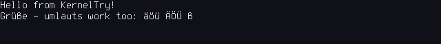

# 3 – Text on the screen

**Goal:** `println!` that writes to the screen – with our own font renderer, character by character, pixel by pixel.
**You end up with:**



**Code:** [`course/03-console/`](https://github.com/FreakySneaky787/yak-kernel/tree/main/course/03-console) (chapter 2
plus `font.rs`, `console.rs`, the font file and the `spin` crate)

## Background: a framebuffer
Old PCs had a *text mode*: write a character code to address `0xB8000` and the graphics card draws it. UEFI
machines no longer have it. What every machine has is a **framebuffer** – a region of memory in which every pixel
of the screen is a few bytes. Write `0x00FF0000` into the right place and that pixel turns red. Everything else –
letters, lines, windows – is software.

Limine sets a graphics mode for us and tells us where the framebuffer is, if we ask:

```rust,file=kernel/src/main.rs
/// A framebuffer: memory whose bytes are the pixels on the screen. Limine sets up a graphics mode for us.
#[used]
#[unsafe(link_section = ".limine_requests")]
static FRAMEBUFFER: FramebufferRequest = FramebufferRequest::new();
```

The answer has five numbers we need: the **address**, **width** and **height** in pixels, **bpp** (bits per pixel;
we only handle 32: one `u32` per pixel, `0x00RRGGBB`) and the **pitch** – the number of *bytes* from one row of
pixels to the next. The pitch can be larger than `width × 4`; graphics hardware likes rows aligned to round
numbers. Forgetting the pitch gives a slanted, garbled picture.

## Step 1: a font – PSF2
To draw a letter we need its shape. We use the console font of Linux, **Terminus 8×16**, in the PSF2 format: every
glyph is 16 bytes, one byte per pixel row, the highest bit is the leftmost pixel. An `A` looks like this
(`#` = bit set):

```text
........
...##...
..#..#..
.#....#.
.#....#.
.######.
.#....#.
.#....#.
```
(the real glyph is 16 rows; this is a sketch). The file is built into the kernel – there is no file system yet:

```rust,file=kernel/src/font.rs
/// The font built into the kernel: Terminus 8x16 (SIL Open Font License, see assets/README.md).
pub static TERMINUS: &[u8] = include_bytes!("../assets/terminus-8x16.psf");
```

`Font::parse` checks the magic number `0x864ab572`, reads the glyph size from the header and builds a table from
characters to glyph numbers. The table is needed because glyph 65 is not necessarily `A`: after the glyphs, the
file lists for each glyph which Unicode characters it shows (`read_unicode_table`). We keep characters below 256 –
enough for English and German. Everything else is drawn as `?`:

```rust,file=kernel/src/font.rs
    /// The pixel rows of the glyph for `c` (one byte per row); characters the font lacks become '?'.
    pub fn glyph(&self, c: char) -> &[u8] {
        let index = self.index_of(c).or_else(|| self.index_of('?')).unwrap_or(0);
        let start = self.glyph_offset + index * self.height;
        &self.data[start..start + self.height]
    }
```

## Step 2: drawing a character
The console divides the screen into cells of 8×16 pixels – on QEMU's 1280×800 screen that is 160 × 50 characters.
Drawing a character means: for every row of its glyph, for every bit, one pixel:

```rust,file=kernel/src/console.rs
    /// Draws the glyph of `c` into the cell at `column`, `row`: every font bit becomes one pixel.
    fn draw(&mut self, c: char, column: usize, row: usize) {
        let (x0, y0) = (column * self.font.width, row * self.font.height);
        for (dy, bits) in self.font.glyph(c).iter().enumerate() {
            let line = (y0 + dy) * self.stride + x0;
            for dx in 0..self.font.width {
                let on = bits & (0x80 >> dx) != 0; // the highest bit is the leftmost pixel
                self.pixels[line + dx] = if on { FOREGROUND } else { BACKGROUND };
            }
        }
    }
```

`stride` is the pitch in pixels (`pitch / 4`). Note that the console does not draw to "the screen" but into
`pixels: &mut [u32]` – any piece of memory. That is what makes it testable (step 5).

## Step 3: lines, wrapping, scrolling
`put_char` keeps a cursor (`column`, `row`). `\n` moves to the next line; a full line wraps; and when the cursor
falls off the bottom, everything moves up by one text row:

```rust,file=kernel/src/console.rs
    /// Moves every text row up by one (copying pixels) and clears the bottom one.
    fn scroll(&mut self) {
        let row_pixels = self.font.height * self.stride; // one row of text, in pixels
        let used = self.rows * row_pixels;
        self.pixels.copy_within(row_pixels..used, 0);
        self.pixels[used - row_pixels..used].fill(BACKGROUND);
    }
```

That is a copy of almost 4 MB per scrolled line – slow, but simple and correct. (The reference kernel keeps the
characters in a grid as well and redraws from it; that is an optimisation for later.)

## Step 4: a global console and `println!`
Code everywhere in the kernel should be able to print, so the console is a global. A global that changes needs
protection against two users at once; with only one CPU and no interrupts yet that cannot happen, but Rust does not
know that and insists – rightly: interrupts come in a later chapter, and then a second user can appear any time. We use a spin lock from the `spin` crate:

```rust,file=kernel/src/console.rs
/// The console on the screen - `None` until `init` found a framebuffer.
pub static CONSOLE: Mutex<Option<Console<'static>>> = Mutex::new(None);
```

`init` turns Limine's answer into a `Console` – the one `unsafe` step, creating a slice from the framebuffer
address, is where we promise Rust that this memory really is ours. `print!` and `println!` write to the console
**and** the serial port, so the tests from chapter 2 still see everything.

## Step 5: testing a picture
How do you test drawing without looking at a screen? Draw into a tiny screen in memory – 10 × 3 characters, with a
stride of 88 pixels for an 80-pixel-wide picture, so that a pitch mistake shows up – and check the pixels:

```rust,file=kernel/src/console.rs
    #[test_case]
    fn a_full_screen_scrolls_up() {
        let mut pixels = [0u32; STRIDE * H];
        let mut c = console(&mut pixels);
        write!(c, "a\nb\nc\nd").unwrap(); // 4 lines on a 3-row screen: "a" scrolls away
        assert!(shows(&pixels, 0, 0, 'b') && shows(&pixels, 0, 1, 'c') && shows(&pixels, 0, 2, 'd'));
    }
```

`shows` compares a cell with the font's glyph, pixel by pixel. Together with tests for placement, wrapping, the
padding right of the picture and the font parser, `make test` now runs 12 tests – and one more on the real
framebuffer: the console must cover the whole screen Limine gave us.

## Run it
```sh
cd course/03-console
make run
```
The QEMU window shows the two lines from the picture above; the terminal shows them too (serial port), plus the
console size:

```text
Hello from KernelTry!
Console: 160 x 50 characters
Grüße - umlauts work too: äöü ÄÖÜ ß
```

## What can go wrong
- **Slanted or torn text:** the pitch was ignored (`width` used instead of `stride`). The test with the 88-pixel
  stride catches exactly this.
- **Some characters show up as `?`:** they are not in our Latin-1 table – for example `–` (U+2013, a dash) or `€`.
  That is the fallback working, not a bug.
- **Nothing on the screen, but the serial port works:** Limine gave no 32-bit framebuffer (`bpp != 32`), and
  `init` left `CONSOLE` at `None`.
- **The kernel hangs in `println!`:** a spin lock taken twice – for example a panic while the console is locked, if
  the panic handler prints to the console. Our panic handler only uses the serial port, and our `Serial` has no lock (it has no state to protect). (The
  reference kernel's panic handler uses `try_lock` for the console – see `panic_report` in `kernel/src/lib.rs`.)

## Experiments
1. Swap `FOREGROUND` and `BACKGROUND`. Then try `0x00FF0000` – which colour, and why is the byte order `RRGGBB`?
2. Print 60 lines in a loop and watch it scroll. How long does it take (count with the serial output)?
3. Draw every pixel of a glyph twice as wide and twice as high (a 16×32 console). What has to change?
